<p align="center">
  
</p>

<p align="center">
  <strong>Speak it. See it handwritten. Print it.</strong>
</p>

<p align="center">
  <a href="LICENSE"></a>
  <a href="https://github.com/codexmaham/qalam/actions/workflows/ci.yml"></a>
  
  
  <a href="CONTRIBUTING.md"></a>
  <a href="https://github.com/codexmaham/qalam/stargazers"></a>
</p>

<p align="center">
  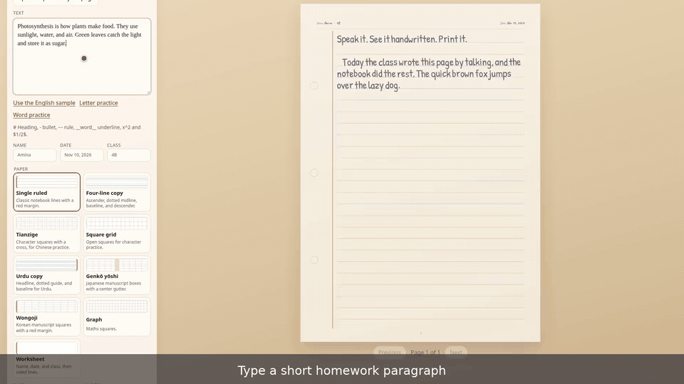
</p>

<p align="center">
  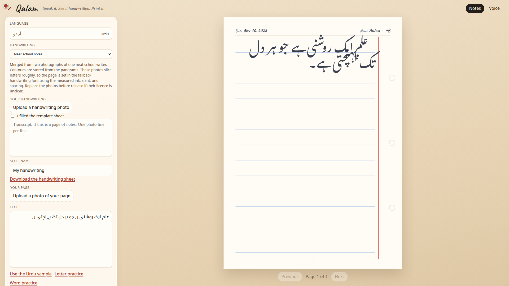
  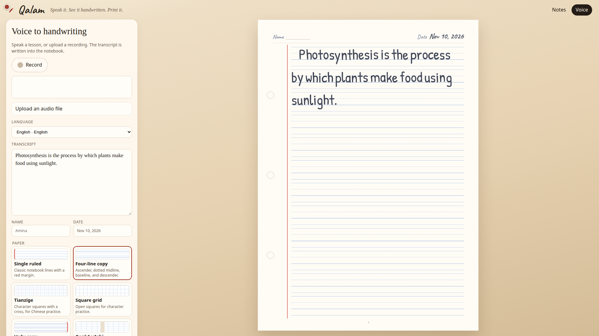
</p>

<!--
Full demo video (MP4). It is not stored in this repository.
Upload the file with GitHub's editor, then replace this comment with the attachment:


-->

## Why Qalam

A lesson should look like a notebook page. Qalam runs on the school computer: you type or you speak, and the page on screen is the page you print. Nothing is uploaded. An 8 GB MacBook Air is enough.

| | |
| --- | --- |
| **Voice to homework** | Record or upload audio. Whisper transcribes on this computer, and the notebook writes the page. |
| **Your own handwriting** | Upload a sample, or the printed template sheet. That hand becomes the default. |
| **Write on your page** | Photograph a notebook. Qalam finds the rules and writes on the empty lines. |
| **42 languages** | Latin, right-to-left Arabic and Urdu, Devanagari, and Chinese, Japanese, and Korean. Shaped with HarfBuzz, not drawn character by character. |
| **Practice and worksheets** | Dotted letters and words, graph paper, and a sheet with name, date, and class. |
| **PDF export** | Download the page as A4 or US Letter PDF, or as a PNG. |
| **Fully offline** | Fonts ship in the repo. An 8 GB M1 runs the renderer and Whisper. The only download is the Whisper model, once. |

## Quick start

**macOS.** Python, ffmpeg, and Node come from Homebrew.

```bash
git clone https://github.com/codexmaham/qalam.git
cd qalam
./scripts/setup-macos.sh
cd backend
source .venv/bin/activate
python3 -m uvicorn qalam.main:app --host 127.0.0.1 --port 8000
```

Open http://127.0.0.1:8000.

On Linux, use Python 3.11+, Node 20+, and ffmpeg, then the same `venv` and `npm` steps. Details are in [CONTRIBUTING.md](CONTRIBUTING.md).

**Docker**

```bash
docker compose up --build
```

The container listens on port 8000. Saved handwriting and the Whisper download stay in two volumes.

## Languages

42 languages. **Handwriting** is an open pen, brush, or handwriting face. **Text face** means no open handwriting font covers that script, so the page says so and uses a text face.

| Language | Native | Script | Direction | Font | Kind |
| --- | --- | --- | --- | --- | --- |
| English | English | Latin | LTR | Caveat | Handwriting |
| Spanish | Español | Latin | LTR | Caveat | Handwriting |
| French | Français | Latin | LTR | Caveat | Handwriting |
| German | Deutsch | Latin | LTR | Caveat | Handwriting |
| Portuguese | Português | Latin | LTR | Caveat | Handwriting |
| Italian | Italiano | Latin | LTR | Caveat | Handwriting |
| Turkish | Türkçe | Latin | LTR | Caveat | Handwriting |
| Indonesian | Bahasa Indonesia | Latin | LTR | Caveat | Handwriting |
| Vietnamese | Tiếng Việt | Latin | LTR | Patrick Hand | Handwriting |
| Dutch | Nederlands | Latin | LTR | Caveat | Handwriting |
| Polish | Polski | Latin | LTR | Caveat | Handwriting |
| Swedish | Svenska | Latin | LTR | Caveat | Handwriting |
| Czech | Čeština | Latin | LTR | Caveat | Handwriting |
| Romanian | Română | Latin | LTR | Caveat | Handwriting |
| Hungarian | Magyar | Latin | LTR | Caveat | Handwriting |
| Malay | Bahasa Melayu | Latin | LTR | Caveat | Handwriting |
| Swahili | Kiswahili | Latin | LTR | Caveat | Handwriting |
| Filipino | Filipino | Latin | LTR | Caveat | Handwriting |
| Catalan | Català | Latin | LTR | Caveat | Handwriting |
| Russian | Русский | Cyrillic | LTR | Bad Script | Handwriting |
| Ukrainian | Українська | Cyrillic | LTR | Bad Script | Handwriting |
| Bulgarian | Български | Cyrillic | LTR | Bad Script | Handwriting |
| Serbian | Српски | Cyrillic | LTR | Bad Script | Handwriting |
| Arabic | العربية | Arabic | RTL | Aref Ruqaa Ink | Handwriting |
| Persian | فارسی | Arabic | RTL | Aref Ruqaa Ink | Handwriting |
| Urdu | اردو | Arabic | RTL | Gulzar | Handwriting |
| Punjabi (Shahmukhi) | پنجابی | Arabic | RTL | Gulzar | Handwriting |
| Pashto | پښتو | Arabic | RTL | Lateef | Text face |
| Sindhi | سنڌي | Arabic | RTL | Lateef | Text face |
| Hindi | हिन्दी | Devanagari | LTR | Kalam | Handwriting |
| Marathi | मराठी | Devanagari | LTR | Kalam | Handwriting |
| Nepali | नेपाली | Devanagari | LTR | Kalam | Handwriting |
| Sanskrit | संस्कृतम् | Devanagari | LTR | Kalam | Handwriting |
| Punjabi (Gurmukhi) | ਪੰਜਾਬੀ | Gurmukhi | LTR | Mukta Mahee | Text face |
| Bengali | বাংলা | Bengali | LTR | Galada | Handwriting |
| Tamil | தமிழ் | Tamil | LTR | Kavivanar | Handwriting |
| Telugu | తెలుగు | Telugu | LTR | Akaya Telivigala | Handwriting |
| Gujarati | ગુજરાતી | Gujarati | LTR | Mukta Vaani | Text face |
| Thai | ไทย | Thai | LTR | Sriracha | Handwriting |
| Chinese (Simplified) | 简体中文 | Chinese | LTR | ZCOOL KuaiLe | Handwriting |
| Japanese | 日本語 | Japanese | LTR | Klee One | Handwriting |
| Korean | 한국어 | Korean | LTR | Nanum Pen Script | Handwriting |

Urdu and Shahmukhi are set in Gulzar (Nastaliq). Pashto, Sindhi, Gurmukhi, and Gujarati use a text face because no open handwriting font we could ship covers their letters. Add a language with a font file plus a block in `backend/languages.toml`. The steps are in [CONTRIBUTING.md](CONTRIBUTING.md).

## Gallery

<table>
  <tr>
    <td align="center">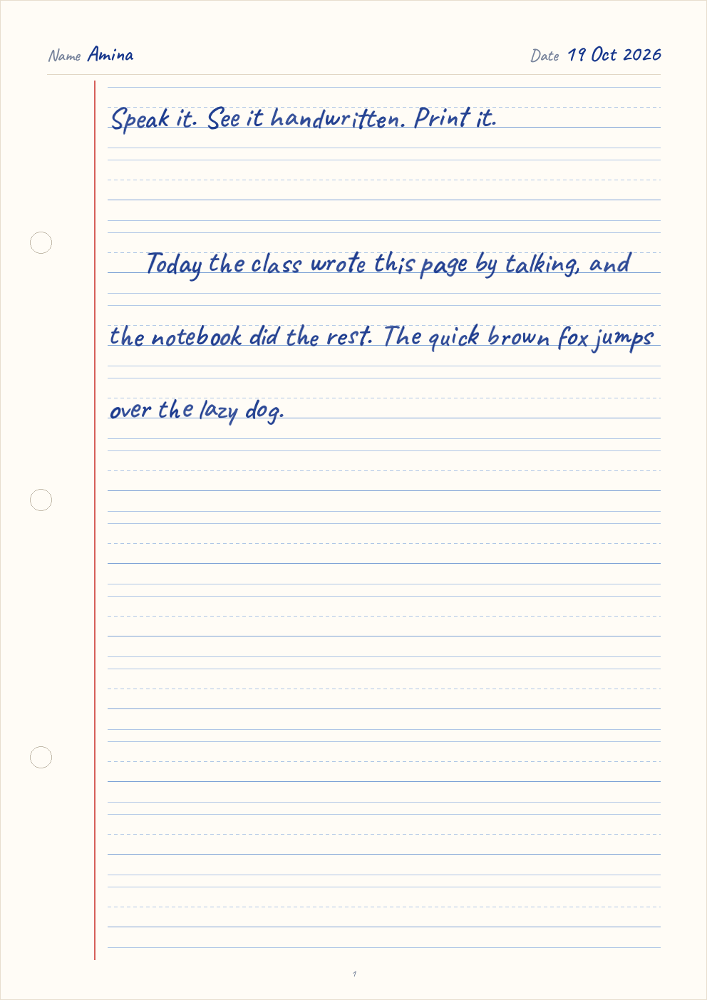<br>English</td>
    <td align="center">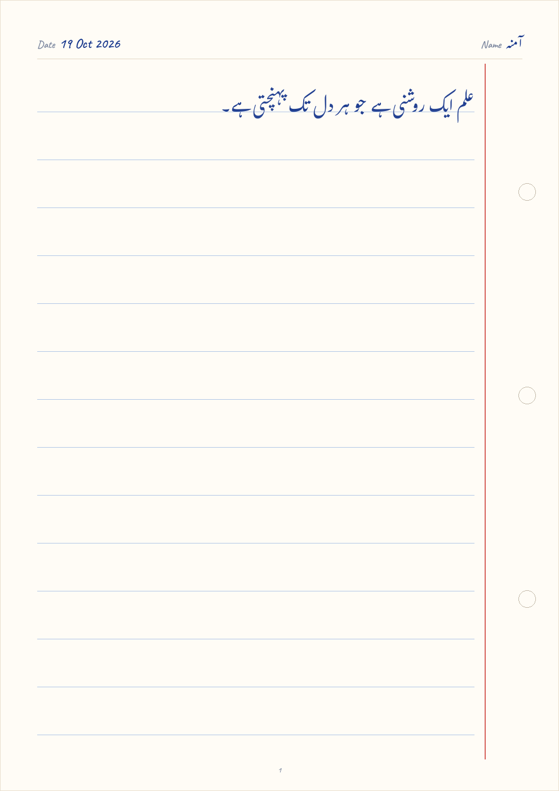<br>Urdu</td>
    <td align="center">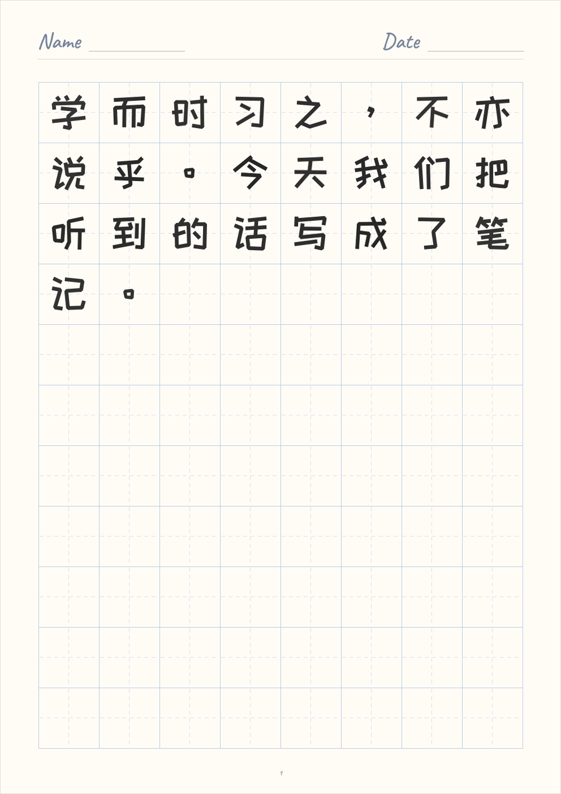<br>Chinese</td>
    <td align="center">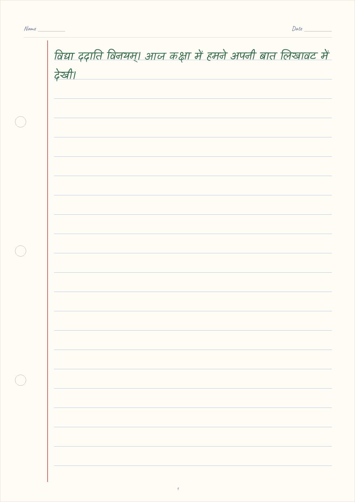<br>Hindi</td>
  </tr>
  <tr>
    <td align="center">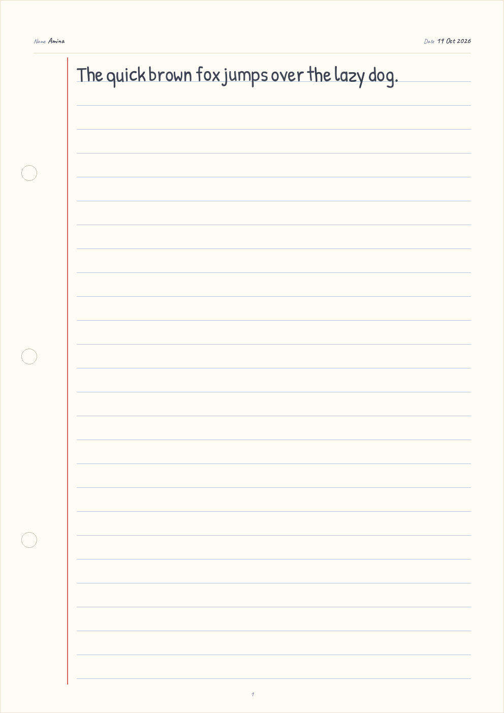<br>Neat school notes</td>
    <td align="center">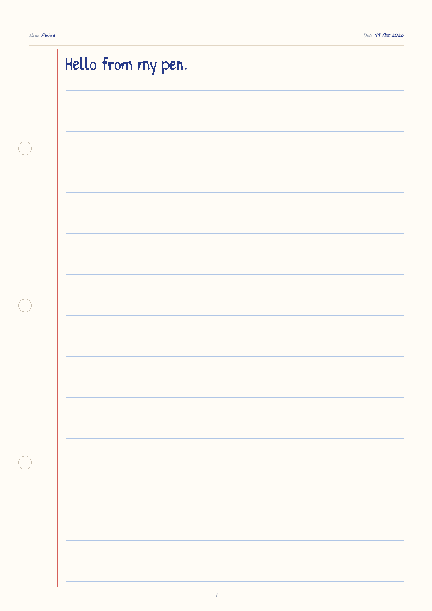<br>Your hand</td>
    <td align="center">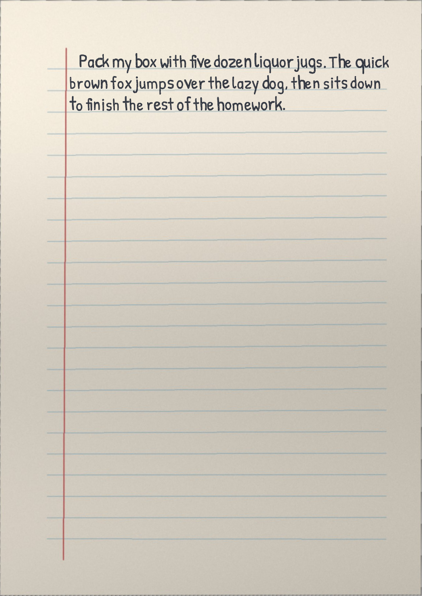<br>Your page</td>
    <td align="center">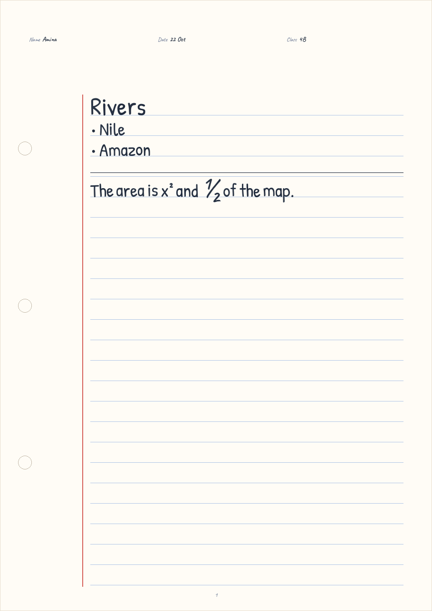<br>Worksheet</td>
  </tr>
  <tr>
    <td align="center">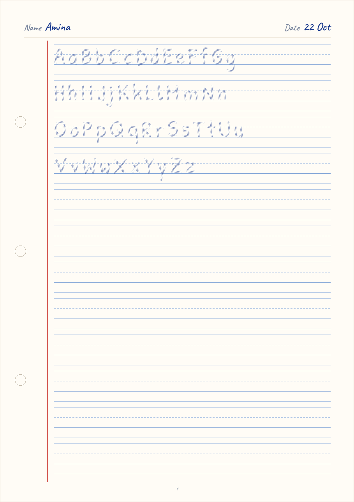<br>Practice</td>
    <td align="center">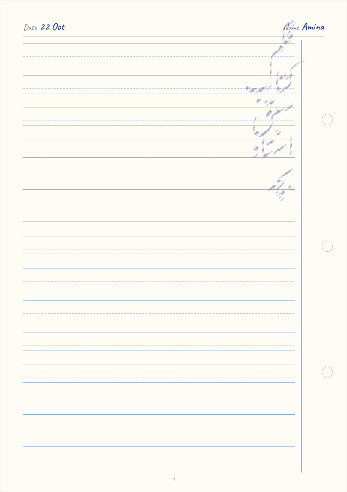<br>Urdu practice</td>
    <td align="center">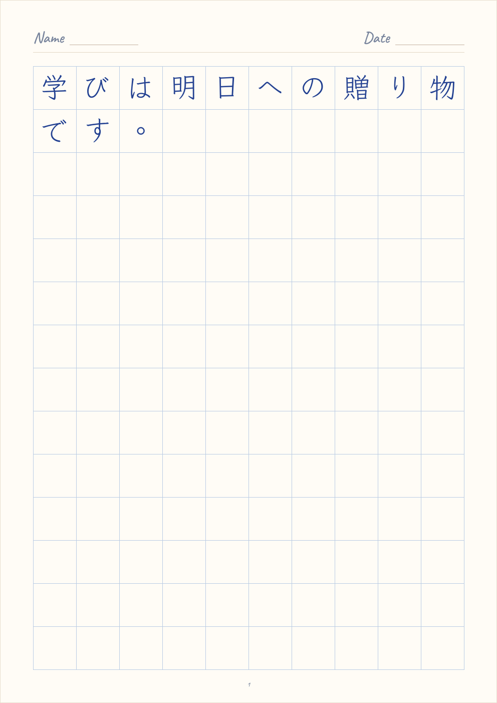<br>Japanese</td>
    <td align="center">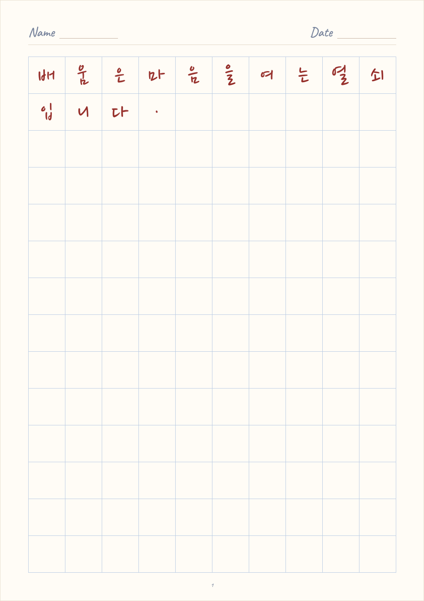<br>Korean</td>
  </tr>
</table>

More pages live in [`samples/`](samples/), including Arabic, graph paper, stroke hand, and the practice grids for Chinese, Japanese, and Korean.

## How it works

The browser is a small React app. A Python service on the same machine shapes the text, draws the page, and runs Whisper.

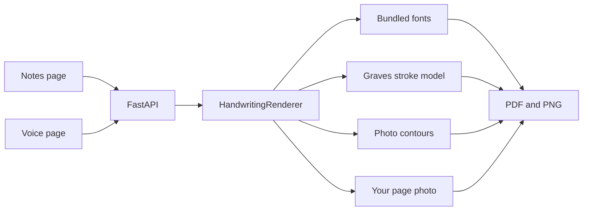

Arabic words stay joined. Indic and Thai marks stay on their bases. Latin letters move one by one. The same function draws the preview, the PNG, and the PDF.

## Roadmap

Shipped: practice sheets, graph and worksheet paper, A4 and Letter, margins, pen thickness, homework markup, the Graves stroke style for Latin, a saved handwriting default, local Whisper, and Docker.

Still open:

- Vertical genkō yōshi. This version is horizontal, with a centre gutter.
- A stroke model for scripts other than Latin.
- A one-shot model that can invent a joined hand from one photo.
- Dictionary line-breaking for Thai.
- Handwriting faces for the scripts that are still on a text face.
- A PDF you can select and copy, not only print.

## Contributing

A new language is a font file plus a block in `backend/languages.toml`. Setup, tests, and the jitter profiles are in [CONTRIBUTING.md](CONTRIBUTING.md). Smaller tasks are listed in [docs/good-first-issues.md](docs/good-first-issues.md).

Security reports go through [SECURITY.md](SECURITY.md). Please do not file those as public issues.

## License

The code is [MIT](LICENSE), copyright Syeda Maham Fatima. The fonts stay under the [SIL Open Font License 1.1](backend/fonts/OFL.txt).

<p align="center">
  <strong>If Qalam is useful, <a href="https://github.com/codexmaham/qalam">star it</a>.</strong>
</p>
