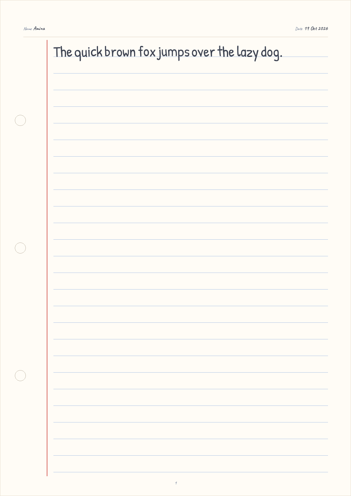
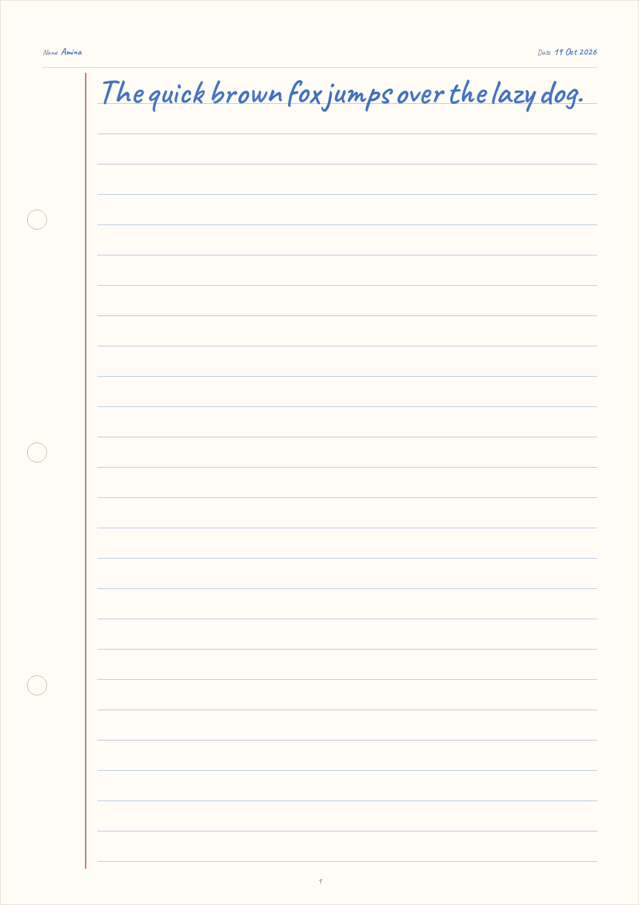
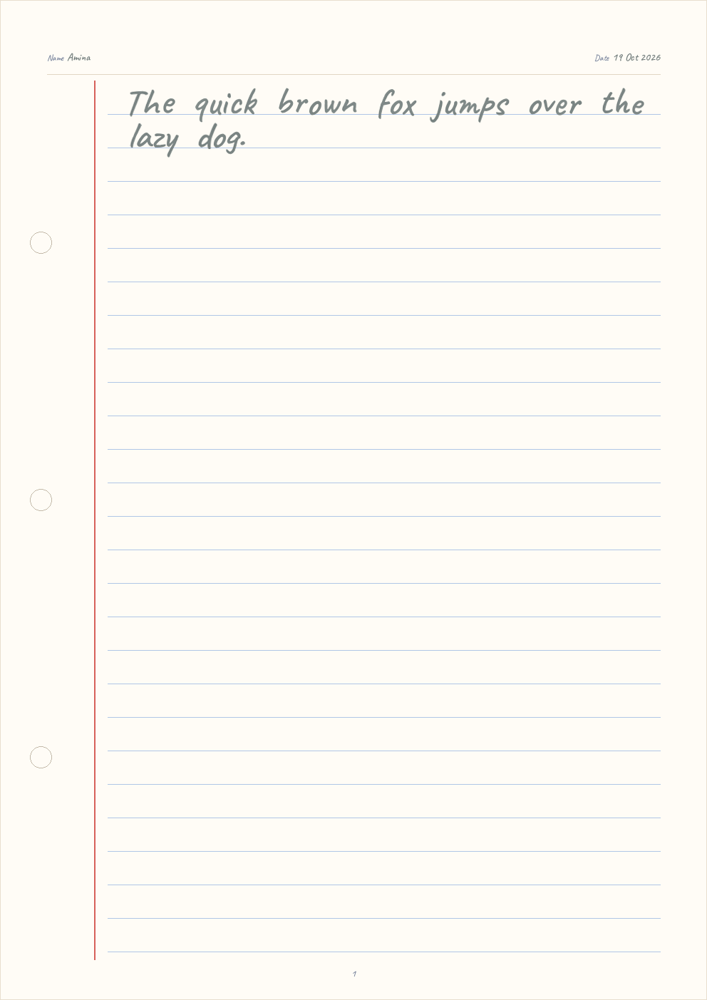
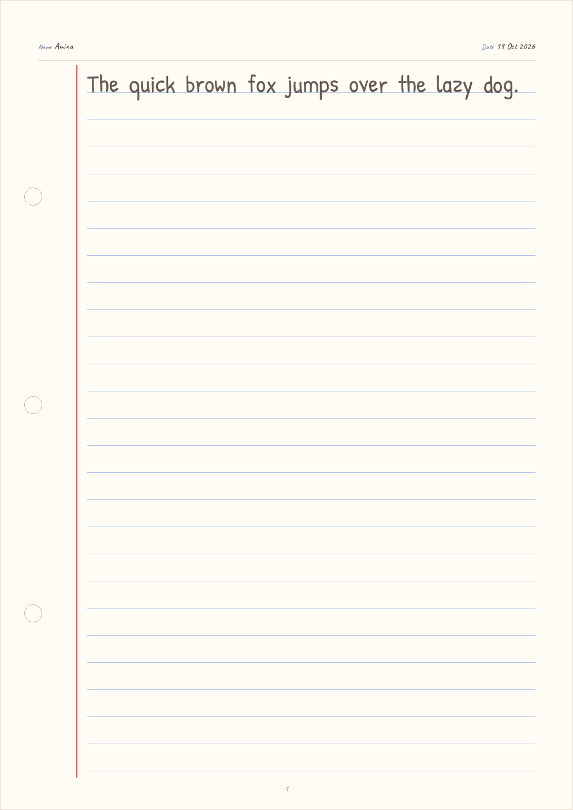
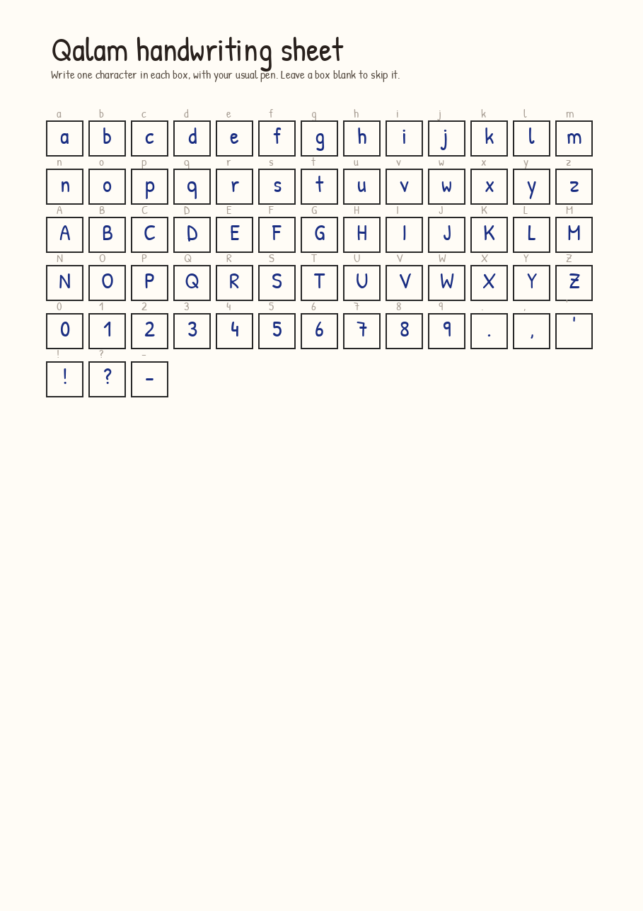
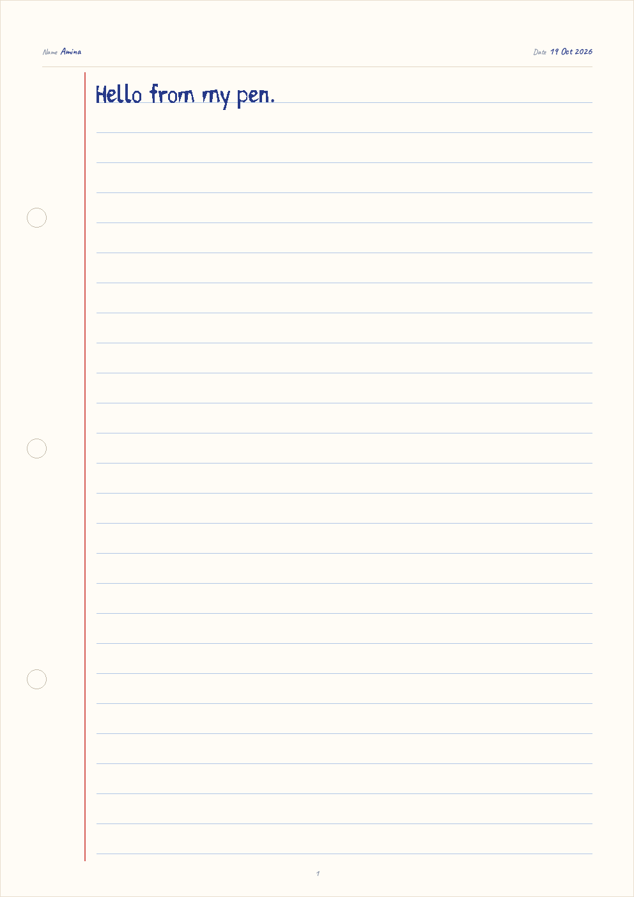
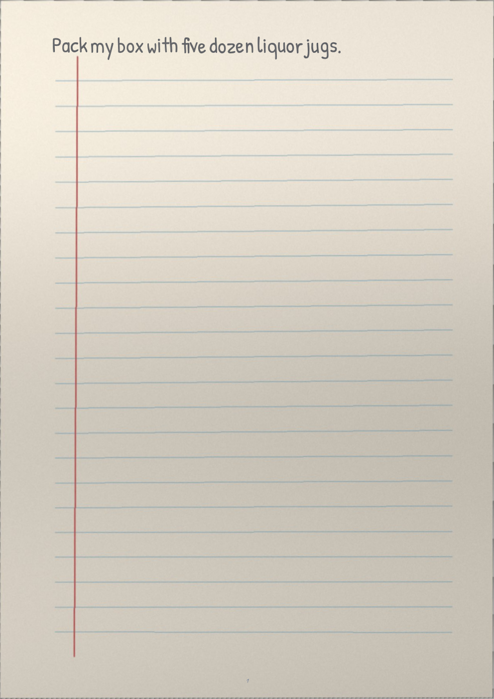
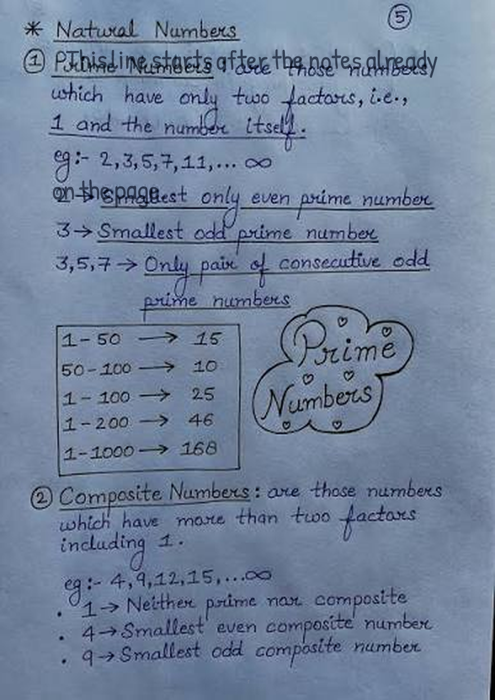
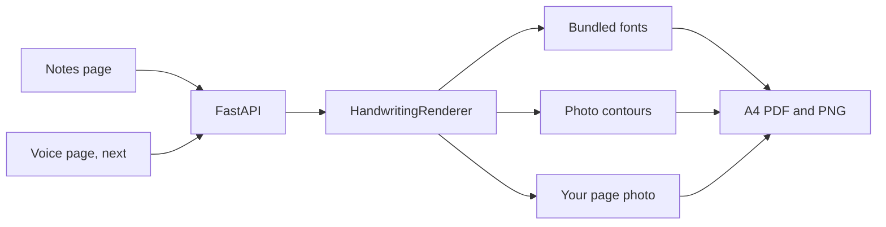

# Qalam

**Speak it. See it handwritten. Print it.**

Qalam (قلم, a pen) turns a lesson into a notebook page. You type or paste the text, pick a language and a paper, and print an A4 PDF. The writing is shaped properly for each script, then nudged a little so it does not look like a font stamped in a straight line.

It runs on the school computer. Nothing is uploaded. A MacBook Air with 8 GB of memory is enough.

This first version is the text path: typed notes, a live page, and a PDF. Voice comes next. Whisper will transcribe on the same machine, and the page you already see will be the page it writes.


## What you can do today

- Type or paste text and watch a notebook page update.
- Choose a language. Right-to-left scripts are set right to left, and complex scripts are shaped with HarfBuzz, not drawn character by character.
- Pick the paper: single-ruled, four-line English copy, tianzige (the Chinese character grid), or an open square grid in the spirit of genkō yōshi and wongoji.
- Pick an ink: ballpoint blue, black, navy, green, red, or pencil.
- Put a name and a date on the sheet.
- Download a multi-page A4 PDF, or a PNG of the page.
- Pick a handwriting style. The default is the neat school hand. Change it with one line in [`backend/qalam/styles/config.py`](backend/qalam/styles/config.py): `DEFAULT_STYLE_ID`.
- Upload a photo of your own page. Qalam straightens it, finds the ruled lines, and writes on those lines.
- Upload a handwriting sample, or fill the printed template sheet, and new text is set from that hand.
- Add a language by adding a font and a block of config. See [CONTRIBUTING.md](CONTRIBUTING.md).

The Voice page is a placeholder. Recording and transcription are the next step, on purpose: the notebook renderer is the part every later feature writes through.

## Handwriting styles

The page can be set in a bundled font, or in a style measured from a photograph. Both go through the same `render` method, so a one-shot handwriting model can replace the contour composer later without changing the page or the API.

| Style | What it is |
| --- | --- |
| Neat school notes | The default. Two pages of one neat school writer, merged. |
| Black cursive letter | A cursive letter in black ink. |
| Blue quick notes | Fast notes in blue. |
| Black print notes | Upright print in black. |
| Qalam fonts | The original multilingual fonts, one per script. |









**What quality to expect.** A photo of ordinary notes does not give clean, separable letters, especially when the writing is joined. Qalam still cuts the photo into contours and stores them, and it measures slant, x-height, letter spacing, stroke width, and ink colour. Those numbers tune the fallback font: the page is set in the closest bundled handwriting face, in the sample's ink, with the slant leaning the jitter. That is an honest limit of a CPU pipeline on an 8 GB machine, not a neural one-shot model.

The reliable way to use your own letters is the **handwriting sheet**. Print it, write one character in each box, and photograph it. Each box is one glyph. Letters are normalised to one shared x-height and one baseline, by their class: x-height letters, ascenders, and descenders. A contour that is the wrong size, a merged blob, or a piece of the box is dropped, and that character is set from the bundled font at the same size.





## Your own page

Leave the paper blank and you get a white A4 sheet with the usual rules. Upload a photo of a notebook page and that photo becomes the paper: Qalam straightens the perspective, finds the ruled lines, and sizes the handwriting so the x-height fits between them. Lines that already contain pen ink are skipped, and the new text starts on the first free line. The ink is the pen already on the page, or the style's ink when the page is blank, multiplied in with a little grain so the paper and the light stay visible. Download the result as a PNG or a PDF.





The preset photographs live in [`backend/assets/handwriting-samples/`](backend/assets/handwriting-samples/README.md), separate from the fonts. They may have come from the internet. Replace them with samples the maintainer owns before a public release if the licence is unclear, then run `python3 scripts/build_presets.py`.


## Languages

42 languages render in this version. “Handwriting” means an open handwriting, brush, or pen face. “Text face” means we could not find an open handwriting font that covers the script, so the page uses a text face and says so.

| Language | Native | Script | Direction | Font | Kind |
| --- | --- | --- | --- | --- | --- |
| English | English | Latin | LTR | Caveat | Handwriting |
| Spanish | Español | Latin | LTR | Caveat | Handwriting |
| French | Français | Latin | LTR | Caveat | Handwriting |
| German | Deutsch | Latin | LTR | Caveat | Handwriting |
| Portuguese | Português | Latin | LTR | Caveat | Handwriting |
| Italian | Italiano | Latin | LTR | Caveat | Handwriting |
| Turkish | Türkçe | Latin | LTR | Caveat | Handwriting |
| Indonesian | Bahasa Indonesia | Latin | LTR | Caveat | Handwriting |
| Vietnamese | Tiếng Việt | Latin | LTR | Patrick Hand | Handwriting |
| Dutch | Nederlands | Latin | LTR | Caveat | Handwriting |
| Polish | Polski | Latin | LTR | Caveat | Handwriting |
| Swedish | Svenska | Latin | LTR | Caveat | Handwriting |
| Czech | Čeština | Latin | LTR | Caveat | Handwriting |
| Romanian | Română | Latin | LTR | Caveat | Handwriting |
| Hungarian | Magyar | Latin | LTR | Caveat | Handwriting |
| Malay | Bahasa Melayu | Latin | LTR | Caveat | Handwriting |
| Swahili | Kiswahili | Latin | LTR | Caveat | Handwriting |
| Filipino | Filipino | Latin | LTR | Caveat | Handwriting |
| Catalan | Català | Latin | LTR | Caveat | Handwriting |
| Russian | Русский | Cyrillic | LTR | Bad Script | Handwriting |
| Ukrainian | Українська | Cyrillic | LTR | Bad Script | Handwriting |
| Bulgarian | Български | Cyrillic | LTR | Bad Script | Handwriting |
| Serbian | Српски | Cyrillic | LTR | Bad Script | Handwriting |
| Arabic | العربية | Arabic | RTL | Aref Ruqaa Ink | Handwriting |
| Persian | فارسی | Arabic | RTL | Aref Ruqaa Ink | Handwriting |
| Urdu | اردو | Arabic | RTL | Gulzar | Handwriting |
| Punjabi (Shahmukhi) | پنجابی | Arabic | RTL | Gulzar | Handwriting |
| Pashto | پښتو | Arabic | RTL | Lateef | Text face |
| Sindhi | سنڌي | Arabic | RTL | Lateef | Text face |
| Hindi | हिन्दी | Devanagari | LTR | Kalam | Handwriting |
| Marathi | मराठी | Devanagari | LTR | Kalam | Handwriting |
| Nepali | नेपाली | Devanagari | LTR | Kalam | Handwriting |
| Sanskrit | संस्कृतम् | Devanagari | LTR | Kalam | Handwriting |
| Punjabi (Gurmukhi) | ਪੰਜਾਬੀ | Gurmukhi | LTR | Mukta Mahee | Text face |
| Bengali | বাংলা | Bengali | LTR | Galada | Handwriting |
| Tamil | தமிழ் | Tamil | LTR | Kavivanar | Handwriting |
| Telugu | తెలుగు | Telugu | LTR | Akaya Telivigala | Handwriting |
| Gujarati | ગુજરાતી | Gujarati | LTR | Mukta Vaani | Text face |
| Thai | ไทย | Thai | LTR | Sriracha | Handwriting |
| Chinese (Simplified) | 简体中文 | Chinese | LTR | ZCOOL KuaiLe | Handwriting |
| Japanese | 日本語 | Japanese | LTR | Klee One | Handwriting |
| Korean | 한국어 | Korean | LTR | Nanum Pen Script | Handwriting |

Pashto and Sindhi use Lateef, a Naskh text face, because no open handwriting font we could ship covers their letters. Gurmukhi uses Mukta Mahee and Gujarati uses Mukta Vaani for the same reason. Urdu and Shahmukhi use Gulzar, which is Nastaliq, the hand those languages are actually written in.

A test renders every script family, and the suite fails if a language sample shapes to a missing glyph. Thai wraps on grapheme clusters so vowel marks stay with their consonants. Dictionary line-breaking for Thai is still to come.

More sample pages: [Hindi](samples/hindi-single-ruled.png), [Arabic](samples/arabic-single-ruled.png), [Japanese](samples/japanese-square-grid.png), [Korean](samples/korean-square-grid.png).

## Quick start on a Mac

These commands are the same on Linux. Use Python 3.11+ and Node 20+.

```bash
git clone https://github.com/codexmaham/qalam.git
cd qalam

cd backend
python3 -m venv .venv
source .venv/bin/activate
pip install -r requirements.txt
python3 -m uvicorn qalam.main:app --host 127.0.0.1 --port 8000
```

Second terminal:

```bash
cd frontend
npm install
npm run dev
```

Open http://127.0.0.1:5173.

If the page says the renderer is not running, the first terminal is the one to check. The API is only on your machine, at http://127.0.0.1:8000.

```bash
cd backend && source .venv/bin/activate && pytest
```

The Python packages publish macOS arm64 wheels (`uharfbuzz`, `freetype-py`, `Pillow`). You do not need Xcode for a normal install, and you do not need a GPU. A page is a CPU render and comes back in well under a second.

## How it is built

The browser is a small React app. The renderer is a Python service, because the next piece is local speech-to-text and because shaping has to be HarfBuzz.



Text is split into words, or into grapheme clusters for Chinese, Japanese, Korean, and Thai. Each piece is shaped, then jittered in a way that script can survive: Arabic words stay joined, Indic and Thai marks stay on their bases, and Latin letters move one by one. A sample style reuses that path for any character it could not cut out of the photo. The same function draws the preview, the PNG, and the PDF.

Fonts are stored in the repo under the SIL Open Font License so the app works with no network. Copyright lines are in [backend/fonts/NOTICE.md](backend/fonts/NOTICE.md).

## Roadmap

- Voice, with Whisper through whisper.cpp, on this computer. Audio is not uploaded.
- A one-shot handwriting model behind the same renderer interface, so a single sample can synthesise strokes instead of cutting contours out of a photo. The contour composer is the stand-in that model would replace.
- A stroke-synthesis engine for the bundled faces, so the writing varies like a hand instead of a font.
- More paper: dotted tracing, graph, Urdu copy lines, and a worksheet header.
- Vertical genkō yōshi.
- Dictionary line-breaking for Thai.
- Handwriting faces for the scripts that are still on a text face.
- A PDF you can select and copy, not only print.

## Contributing

Adding a language is a font file plus a block in `backend/languages.toml`. The steps, including which jitter profile to pick, are in [CONTRIBUTING.md](CONTRIBUTING.md).

## License

The application code is [MIT](LICENSE). The fonts stay under the [SIL Open Font License 1.1](backend/fonts/OFL.txt).
